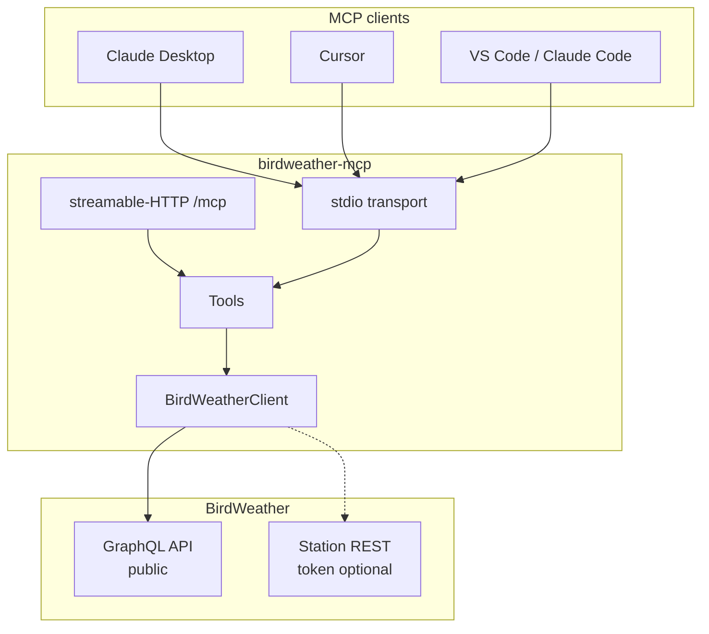

<p align="center">
  
</p>

<p align="center"><em>Ask your AI about the birds your station is hearing — detections, species, and stats via MCP.</em></p>

<p align="center">
  <a href="LICENSE"></a>
  <a href="https://www.python.org/downloads/"></a>
  <a href="https://modelcontextprotocol.io"></a>
  <a href="docs/self-hosting.md"></a>
</p>

# birdweather-mcp

Self-hostable [MCP](https://modelcontextprotocol.io) server for [BirdWeather](https://www.birdweather.com). Point Claude, Cursor, or any MCP client at your (or any public) station and ask natural-language questions about what was detected, what’s trending, and what’s nearby.

Works out of the box against the **public GraphQL API** — no account required. Optionally set a **station token** for richer REST fields. **The token is never logged or echoed.**

## Why this exists

BirdWeather already records rich detection data. This server makes that data **tool-callable** for LLM clients: structured JSON tools instead of scraping the website or hand-writing GraphQL. Clone it, run it locally or on a NAS, keep your token on your machine.

## Features

- **10 MCP tools** — station info, counts, weather, detections, top species, daily series, species search/profiles, nearby stations
- **No auth required** for public GraphQL; optional `BIRDWEATHER_STATION_TOKEN` for REST
- **stdio** (Claude Desktop / Cursor) or **streamable-HTTP** (Docker / Synology / Tailscale)
- **Period helpers** — `days=N` or `from_date`/`to_date` in the station’s timezone
- **Token-safe** — redacted in logs and errors ([SECURITY.md](SECURITY.md))
- **Docker + compose** — multi-arch `python:3.12-slim` (amd64 / arm64, including Synology DS223j-class NAS)

## Quickstart (< 60 seconds)

**uvx** (no clone):

```bash
uvx --from git+https://github.com/pfrederiksen/birdweather-mcp birdweather-mcp
```

**uv** (local checkout):

```bash
git clone https://github.com/pfrederiksen/birdweather-mcp.git
cd birdweather-mcp
uv sync
uv run birdweather-mcp
```

**pip**:

```bash
pip install .
birdweather-mcp
# equivalent: python -m birdweather_mcp
```

**Docker** (stdio for MCP clients that spawn the container):

```bash
docker build -t birdweather-mcp .
docker run --rm -i birdweather-mcp
```

Long-lived HTTP on a NAS / always-on box → [Self-hosting guide](docs/self-hosting.md) (`docker compose up -d`).

### Transports

| Transport | Use case |
|-----------|----------|
| `stdio` (default) | Claude Desktop, Cursor, VS Code, Claude Code |
| `streamable-http` | Remote / Docker / Synology (`http://host:8000/mcp`) |
| `sse` | Legacy SSE clients |

```bash
uv run birdweather-mcp --transport streamable-http --host 127.0.0.1 --port 8000
```

## Find your station ID and token

**Station ID** (public, numeric — e.g. `12345` or `<STATION_ID>` in docs):

1. Open your station on [app.birdweather.com](https://app.birdweather.com) (web) or in the BirdWeather app.
2. Check the URL: `https://app.birdweather.com/stations/<id>` — that number is `station_id`.
3. You can also search by name/coords with the `search_stations` tool once the server is running.

**Station token** (secret — optional):

1. In the BirdWeather app or web UI, open **your** station’s settings.
2. Find the **API / token** section (used for `https://app.birdweather.com/api/v1/stations/<token>/...`).
3. Copy the token into `BIRDWEATHER_STATION_TOKEN` in your MCP config or `.env` — never commit it.

Without a token, all GraphQL tools still work for any public station. With a token, `get_station` can include all-time REST stats and `recent_detections` prefers REST (extra fields).

## Configure MCP clients

### Claude Desktop

`~/Library/Application Support/Claude/claude_desktop_config.json` (macOS) or the equivalent on Windows:

```json
{
  "mcpServers": {
    "birdweather": {
      "command": "uvx",
      "args": ["--from", "git+https://github.com/pfrederiksen/birdweather-mcp", "birdweather-mcp"],
      "env": {
        "BIRDWEATHER_STATION_TOKEN": ""
      }
    }
  }
}
```

Omit `BIRDWEATHER_STATION_TOKEN` (or leave it empty) for public GraphQL only. Local checkout:

```json
{
  "mcpServers": {
    "birdweather": {
      "command": "uv",
      "args": ["run", "--directory", "/absolute/path/to/birdweather-mcp", "birdweather-mcp"]
    }
  }
}
```

### Cursor

Project `.cursor/mcp.json` or Cursor MCP settings:

```json
{
  "mcpServers": {
    "birdweather": {
      "command": "uvx",
      "args": ["--from", "git+https://github.com/pfrederiksen/birdweather-mcp", "birdweather-mcp"]
    }
  }
}
```

### Claude Code

```bash
claude mcp add birdweather -- uvx --from git+https://github.com/pfrederiksen/birdweather-mcp birdweather-mcp
```

Or a project `.mcp.json`:

```json
{
  "mcpServers": {
    "birdweather": {
      "command": "uvx",
      "args": ["--from", "git+https://github.com/pfrederiksen/birdweather-mcp", "birdweather-mcp"]
    }
  }
}
```

### VS Code

`.vscode/mcp.json`:

```json
{
  "servers": {
    "birdweather": {
      "type": "stdio",
      "command": "uvx",
      "args": ["--from", "git+https://github.com/pfrederiksen/birdweather-mcp", "birdweather-mcp"]
    }
  }
}
```

### Generic MCP / HTTP

Any stdio MCP client can spawn `birdweather-mcp` the same way. For a remote streamable-HTTP server (see [docs/self-hosting.md](docs/self-hosting.md)):

```json
{
  "mcpServers": {
    "birdweather": {
      "url": "http://127.0.0.1:8000/mcp"
    }
  }
}
```

Exact key names vary slightly by client version — prefer `url` / `type: "http"` as documented by your client.

## Environment variables

| Variable | Required | Description |
|----------|----------|-------------|
| `BIRDWEATHER_STATION_TOKEN` | No | Station API token. Enables REST detections/stats. **Never logged.** Without it, public GraphQL only. |
| `MCP_TRANSPORT` | No | `stdio` (default), `streamable-http`, or `sse` |
| `MCP_HOST` | No | Bind host for HTTP transports (default `127.0.0.1`) |
| `MCP_PORT` | No | Bind port for HTTP transports (default `8000`) |
| `MCP_ALLOWED_HOSTS` | No | Comma-separated Host headers for HTTP (e.g. `nas.example.local:*`). Unset = loopback only. `*` = allow any host on trusted networks. Fixes `421 Invalid Host header` for MagicDNS/LAN names. |
| `BIRDWEATHER_CACHE_TTL` | No | In-memory upstream cache TTL in seconds (default `60`). Set `0` to disable. |
| `BIRDWEATHER_CACHE_MAX_ENTRIES` | No | Max cached responses (default `256`). |
| `BIRDWEATHER_CACHE_ENABLED` | No | Set `false`/`0` to disable caching. |
| `BIRDWEATHER_MAX_RETRIES` | No | Retries with backoff+jitter on 429/5xx/timeouts (default `5`). |

See `.env.example` for a local template. Streamable-HTTP also serves `GET /health` (no upstream call) for container healthchecks.

## Tools

Full parameter lists and **sample JSON** (placeholders — use your own station id): [docs/tools.md](docs/tools.md).

| Tool | Params (common) | Example prompt |
|------|-----------------|----------------|
| `get_station` | `station_id` | “Describe station 12345 — timezone and coords.” |
| `station_counts` | `station_id`, `days` / dates | “How many detections and species at 12345 last 7 days?” |
| `get_weather` | `station_id` | “Any weather reading for station 12345?” |
| `recent_detections` | `station_id`, `days`, `species`, `min_confidence`, `limit`, `after` | “Show recent House Finch detections at 12345 with confidence ≥ 0.7.” |
| `top_species` | `station_id`, `days`, `limit`, `offset` | “What are the top species at 12345 this week?” |
| `species_list` | same as `top_species` | “List species heard at 12345 in the last 14 days.” |
| `daily_counts` | `station_id`, `days`, `species`, `include_species_breakdown` | “Daily detection totals at 12345 for the last 3 days.” |
| `species_info` | `species_id` / `scientific_name` / `query` | “Tell me about Haemorhous mexicanus.” |
| `search_species` | `query`, `limit`, `after` | “Search the catalog for ‘raven’.” |
| `search_stations` | `lat`, `lon`, `radius_km`, `query` | “Find stations within 20 km of 37.77, −122.42.” |

### Period defaults

- Dates are `YYYY-MM-DD` in the station timezone (or an explicit IANA timezone).
- `days=N` means the last N calendar days **including today**.
- If neither `days` nor dates are given, tools that need a window typically default to **1 day** (`recent_detections`) or **7 days** (counts / top species).

## Example conversations

**You:** What’s station 12345 been hearing this week?

**Assistant:** *(calls `top_species` + `station_counts`)* House Finch leads with hundreds of detections; about 30 species and ~500 detections over the last 7 days in `America/Los_Angeles`.

---

**You:** Any high-confidence House Finches today? Link me a soundscape if you can.

**Assistant:** *(calls `recent_detections` with `species="House Finch"`, `min_confidence=0.7`, `days=1`)* Returns timestamps, confidence, and `soundscape.url` FLAC links when available.

---

**You:** What stations are near 37.77, −122.42?

**Assistant:** *(calls `search_stations` with lat/lon)* Lists nearby PUCs and BirdNET-Pi stations with `distance_km`.

## Architecture



## Self-hosting

Run as a long-lived Docker / compose service (LAN, Tailscale, Synology Container Manager, arm64 builds): **[docs/self-hosting.md](docs/self-hosting.md)**.

```bash
docker compose up -d --build
# MCP endpoint: http://127.0.0.1:8000/mcp
```

## Troubleshooting

| Problem | Fix |
|---------|-----|
| Client shows no tools | Confirm `uvx`/`uv` is on the PATH the GUI app sees; restart the client after config edits |
| `Station … not found` | Check the numeric id in the BirdWeather URL; try `search_stations` |
| Empty detections | Widen `days`, lower `min_confidence`, or confirm the station is active |
| REST / token errors | Token only needed for REST extras; leave unset for GraphQL. Rotate if leaked |
| HTTP client can't connect | Use `http://host:8000/mcp`, bind/publish carefully — see self-hosting guide |
| Docker arm64 “exec format” | Rebuild on the NAS or `docker buildx build --platform linux/arm64` |

## FAQ

**Do I need my own BirdWeather station?**  
No. Any public station id works with GraphQL. A token only unlocks REST for *your* station.

**Is the token sent to the LLM?**  
Tool results do not include the token. Keep it in env/config only; don’t paste it into chat.

**Where do I find my station ID?**  
Open your station on [app.birdweather.com](https://app.birdweather.com); the URL is `…/stations/<id>`. Docs use placeholders like `12345` — substitute your own.

**Can I expose this on the internet?**  
Not recommended without auth. Prefer Tailscale / LAN bind. Details in [SECURITY.md](SECURITY.md).

## Tests

```bash
uv sync --dev
uv run pytest                 # unit tests (mocked network)
# Live smoke needs a public station id (skipped if unset):
BIRDWEATHER_TEST_STATION_ID=<STATION_ID> uv run pytest -m live
```

## Contributing & license

- [CONTRIBUTING.md](CONTRIBUTING.md) · [CHANGELOG.md](CHANGELOG.md) · [SECURITY.md](SECURITY.md)
- API refs: [GraphQL](https://app.birdweather.com/graphql) · [schema docs](https://app.birdweather.com/api/index.html) · Station REST: `/api/v1/stations/<token>/...`
- Licensed under [MIT](LICENSE)
