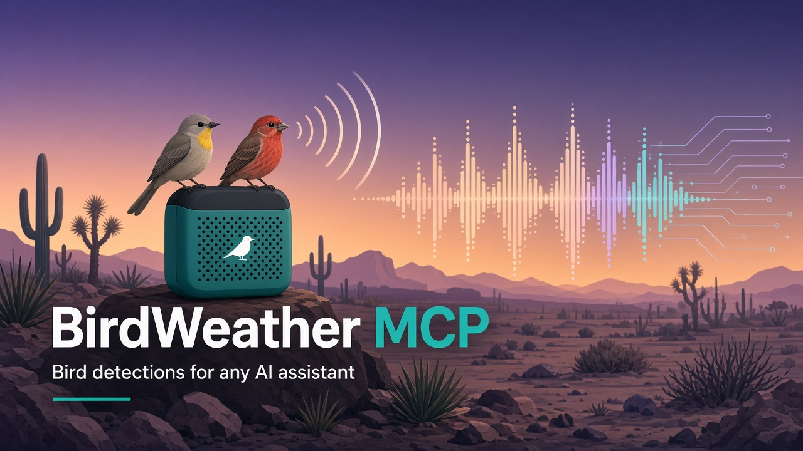
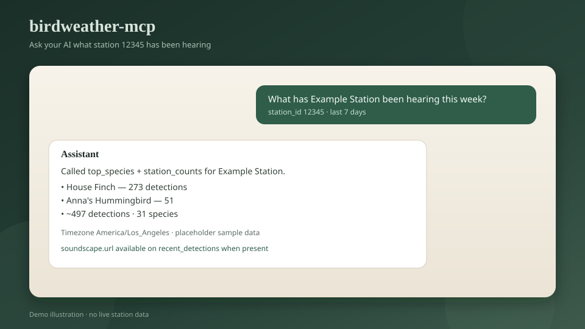

<p align="center">
  
</p>

<p align="center"><em>Ask your AI about the birds your station is hearing — detections, species, and stats via MCP.</em></p>

<p align="center">
  <a href="LICENSE"></a>
  <a href="https://www.python.org/downloads/"></a>
  <a href="https://pypi.org/project/birdweather-mcp/"></a>
  <a href="https://modelcontextprotocol.io"></a>
  <a href="docs/self-hosting.md"></a>
  <a href="https://glama.ai/mcp/servers/pfrederiksen/birdweather-mcp"></a>
</p>

# birdweather-mcp

<!-- mcp-name: io.github.pfrederiksen/birdweather-mcp -->

Self-hostable [MCP](https://modelcontextprotocol.io) server for [BirdWeather](https://www.birdweather.com). Point Claude, Cursor, or any MCP client at your (or any public) station and ask natural-language questions about what was detected, what’s trending, and what’s nearby.

Works out of the box against the **public GraphQL API** — no account required. Optionally set a **station token** for richer REST fields. **The token is never logged or echoed.**

## Features

- **15 MCP tools** — station info, counts, weather, detections, top species, daily series, species trends, new arrivals, station compare, hourly activity, species search/profiles, nearby stations
- **Prompts & resources** — daily/weekly summaries, species deep-dives, and `birdweather://station/…` URIs
- **No auth required** for public GraphQL; optional `BIRDWEATHER_STATION_TOKEN` for REST
- **stdio** (Claude Desktop / Cursor) or **streamable-HTTP** (Docker / Synology / Tailscale)
- **Token-safe** — redacted in logs and errors ([SECURITY.md](SECURITY.md))
- **Docker + compose** — prebuilt multi-arch images on GHCR (`ghcr.io/pfrederiksen/birdweather-mcp`)

## Quickstart

**uvx** (no clone):

```bash
uvx birdweather-mcp
```

**pip / pipx:**

```bash
pip install birdweather-mcp
# or: pipx install birdweather-mcp
birdweather-mcp
```

**Homebrew:**

```bash
brew install pfrederiksen/tap/birdweather-mcp
birdweather-mcp
```

**Docker** (stdio):

```bash
docker pull ghcr.io/pfrederiksen/birdweather-mcp:latest
docker run --rm -i ghcr.io/pfrederiksen/birdweather-mcp:latest
```

Long-lived HTTP on a NAS → [Self-hosting](docs/self-hosting.md). More install paths → [Installation](docs/installation.md). Python / MCP SDK notes → [Requirements & compatibility](docs/installation.md#requirements--compatibility).

Configure Claude Desktop / Cursor / VS Code → [Clients](docs/clients.md).

## Documentation

| Guide | Description |
|-------|-------------|
| [docs/README.md](docs/README.md) | Index of all guides |
| [Installation](docs/installation.md) | uvx, pip, pipx, Homebrew, Docker/GHCR, from source |
| [Configuration](docs/configuration.md) | Environment variables, station ID/token |
| [Clients](docs/clients.md) | Claude Desktop, Cursor, Claude Code, VS Code, HTTP |
| [Tools](docs/tools.md) | Tools, prompts, and resources |
| [Self-hosting](docs/self-hosting.md) | Docker, Synology/arm64, LAN/Tailscale, updates |
| [Development](docs/development.md) | Dev setup, tests, lint, release process |
| [Troubleshooting](docs/troubleshooting.md) | Common problems and FAQ |

## Demo

<p align="center">
  
</p>

Placeholder illustration of asking an MCP client about **Example Station** (`12345`) — not live data.

## License

Licensed under [MIT](LICENSE). See also [CHANGELOG.md](CHANGELOG.md), [CONTRIBUTING.md](CONTRIBUTING.md), and [SECURITY.md](SECURITY.md).
