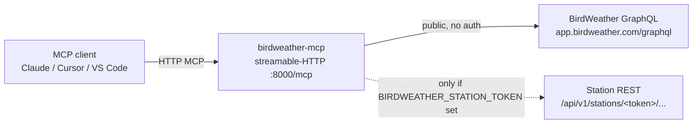

# Self-hosting birdweather-mcp

Run birdweather-mcp as a **long-lived streamable-HTTP** service so MCP clients on your LAN, Tailscale network, or Synology NAS can reach it without spawning a new process per session.

> **Security first:** bind to loopback, LAN, or Tailscale only. Do **not** publish port 8000 to the public internet without an authenticated reverse proxy. See [SECURITY.md](../SECURITY.md).

## Quick start (Docker Compose)

From the repo root:

```bash
docker compose up -d --build
```

- MCP endpoint: `http://127.0.0.1:8000/mcp`
- Optional token: `export BIRDWEATHER_STATION_TOKEN=...` before `up`, or put it in a gitignored `.env` next to `docker-compose.yml`.

Check status:

```bash
docker compose ps
docker compose logs -f birdweather-mcp
```

Stop:

```bash
docker compose down
```

### Plain Docker

```bash
docker build -t birdweather-mcp .
docker run --rm -d \
  --name birdweather-mcp \
  -e MCP_TRANSPORT=streamable-http \
  -e MCP_HOST=0.0.0.0 \
  -e MCP_PORT=8000 \
  -e BIRDWEATHER_STATION_TOKEN \
  -p 127.0.0.1:8000:8000 \
  birdweather-mcp --transport streamable-http --host 0.0.0.0 --port 8000
```

Inside the container `MCP_HOST=0.0.0.0` is correct (listen on the container network). The **host** publish flag `-p 127.0.0.1:8000:8000` is what keeps it off the public interface.

### Without Docker

```bash
uv sync
uv run birdweather-mcp --transport streamable-http --host 127.0.0.1 --port 8000
```

Use a process supervisor (`systemd`, `launchd`, Synology Task Scheduler) if you need restart-on-boot without containers.

## Architecture (HTTP mode)



## Securing the service

| Approach | When to use |
|----------|-------------|
| Publish `127.0.0.1:8000` only | Same machine as the MCP client |
| Bind to LAN IP / firewall allowlist | Trusted home network |
| Tailscale / WireGuard | Access from phone/laptop away from home |
| Reverse proxy + auth (Caddy, Nginx, Traefik) | Multiple users or semi-trusted network |

**Do not** combine `-p 8000:8000` (all interfaces) with an unauthenticated public IP.

Optional reverse-proxy sketch (Caddy) — terminate TLS and require basic auth before `/mcp`:

```caddyfile
mcp.home.example {
  basicauth {
    # generate with: caddy hash-password
    user JDJhJDE0J...
  }
  reverse_proxy 127.0.0.1:8000
}
```

Point remote MCP clients at `https://mcp.home.example/mcp` only if your client supports HTTP MCP + your auth scheme.

## Healthcheck

The image and compose file include a TCP healthcheck on `MCP_PORT` (default `8000`). For `stdio` transport the check exits successfully immediately (nothing listens).

```bash
docker inspect --format='{{.State.Health.Status}}' birdweather-mcp
```

A rough liveness probe from the host (expect a non-connection-refused response; `/mcp` may return `406`/`405` for naive GETs — that still means the process is up):

```bash
curl -s -o /dev/null -w "%{http_code}\n" http://127.0.0.1:8000/mcp
```

## Updating

```bash
git pull
docker compose up -d --build
```

Or rebuild a tagged image and recreate the container. Compose `restart: unless-stopped` brings the new container back on reboot.

## Synology NAS (Container Manager)

Works on x86 and **arm64** models (e.g. **DS223j**). The base image `python:3.12-slim` is multi-arch; build **on the NAS** (or cross-build with buildx) so you get `linux/arm64`.

### Option A — Container Manager UI

1. Install **Container Manager** from Package Center.
2. Copy this repo to the NAS (File Station, `git clone` over SSH, or sync).
3. **Project** → **Create** → select the folder that contains `docker-compose.yml`.
4. Set environment `BIRDWEATHER_STATION_TOKEN` if needed (Project settings → Environment). Leave empty for public GraphQL only.
5. Confirm port mapping is `127.0.0.1:8000:8000` (or your LAN IP). Avoid `0.0.0.0` unless firewalled.
6. Build and start the project. Watch **Logs** for `Uvicorn running on http://0.0.0.0:8000`.

### Option B — SSH + Docker

```bash
cd /volume1/docker/birdweather-mcp   # path may vary
docker compose up -d --build
```

### arm64 image builds

On the NAS itself, a normal build pulls the matching slim image:

```bash
docker build -t birdweather-mcp:local .
```

From an amd64 machine, cross-build:

```bash
docker buildx build --platform linux/arm64 -t birdweather-mcp:local --load .
```

Multi-arch push to a registry:

```bash
docker buildx build --platform linux/amd64,linux/arm64 \
  -t youruser/birdweather-mcp:0.1.0 --push .
```

Low-power ARM boxes (DS223j class) will build slowly the first time; prefer building once and restarting the container for updates when only env changes.

### Reaching the NAS from MCP clients

- **Same LAN:** `http://<nas-lan-ip>:8000/mcp` (only if you mapped a LAN interface intentionally).
- **Tailscale on the NAS:** `http://100.x.y.z:8000/mcp`.
- Prefer Tailscale or VPN over Synology QuickConnect / public port forwards for MCP.

## Connecting clients to HTTP

Clients that support remote / HTTP MCP can use the streamable-HTTP URL. Example shape (exact keys vary by client version):

```json
{
  "mcpServers": {
    "birdweather": {
      "url": "http://127.0.0.1:8000/mcp"
    }
  }
}
```

For Claude Desktop / Cursor on the same machine, **stdio via `uvx`** is often simpler. Use HTTP when the server must live on a NAS or always-on box.

## Troubleshooting

| Symptom | What to try |
|---------|-------------|
| Container unhealthy | `docker compose logs`; ensure `MCP_TRANSPORT=streamable-http` |
| Connection refused | Port mapping / firewall; confirm `docker compose ps` shows running |
| Client can't negotiate MCP | URL must include `/mcp`; client must speak streamable-HTTP |
| arm64 exec format error | Image was built for amd64 — rebuild on the NAS or `--platform linux/arm64` |
| Token not taking effect | Restart container after setting env; confirm REST-only features need the token |

More FAQ items live in the [README](../README.md#faq).
