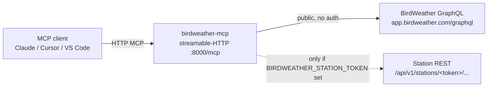

# Self-hosting birdweather-mcp

Run birdweather-mcp as a **long-lived streamable-HTTP** service so MCP clients on your LAN, Tailscale network, or Synology NAS can reach it without spawning a new process per session.

> **Security first:** bind to loopback, LAN, or Tailscale only. Do **not** publish port 8000 to the public internet without an authenticated reverse proxy. See [SECURITY.md](../SECURITY.md).

## Quick start (Docker Compose)

From the repo root:

```bash
docker compose up -d --build
```

- MCP endpoint: `http://127.0.0.1:8000/mcp`
- Optional token: put `BIRDWEATHER_STATION_TOKEN=...` in a gitignored `.env` (mode `600`) next to `docker-compose.yml`, or use `env_file` — never inline the token in compose.

Check status:

```bash
docker compose ps
docker compose logs -f birdweather-mcp
```

Stop:

```bash
docker compose down
```

### Plain Docker

```bash
docker build -t birdweather-mcp .
docker run --rm -d \
  --name birdweather-mcp \
  -e MCP_TRANSPORT=streamable-http \
  -e MCP_HOST=0.0.0.0 \
  -e MCP_PORT=8000 \
  --env-file .env \
  -p 127.0.0.1:8000:8000 \
  birdweather-mcp --transport streamable-http --host 0.0.0.0 --port 8000
```

Inside the container `MCP_HOST=0.0.0.0` is correct (listen on the container network). The **host** publish flag `-p 127.0.0.1:8000:8000` is what keeps it off the public interface.

### Without Docker

```bash
uv sync
uv run birdweather-mcp --transport streamable-http --host 127.0.0.1 --port 8000
```

Use a process supervisor (`systemd`, `launchd`, Synology Task Scheduler) if you need restart-on-boot without containers.

## Architecture (HTTP mode)



## Securing the service

| Approach | When to use |
|----------|-------------|
| Publish `127.0.0.1:8000` only | Same machine as the MCP client |
| Bind to LAN IP / firewall allowlist | Trusted home network |
| Tailscale / WireGuard | Access from phone/laptop away from home |
| Reverse proxy + auth (Caddy, Nginx, Traefik) | Multiple users or semi-trusted network |

**Do not** combine `-p 8000:8000` (all interfaces) with an unauthenticated public IP.

### Allowed Host headers (`MCP_ALLOWED_HOSTS`)

Streamable-HTTP uses MCP DNS-rebinding protection. By default only `localhost` / `127.0.0.1` / `[::1]` Host headers are accepted. Clients that call the server by a LAN hostname or MagicDNS name get **`421 Invalid Host header`**.

| `MCP_ALLOWED_HOSTS` | Effect |
|---------------------|--------|
| *(unset)* | FastMCP defaults (loopback only) |
| `nas.example.local:*,192.168.1.10:*` | Allow those Host values (any port with `:*`); loopback remains allowed |
| `*` | Disable DNS rebinding protection — **trusted networks only** |

Examples:

```bash
# Allow a MagicDNS / LAN hostname (comma-separated; :* = any port)
MCP_ALLOWED_HOSTS=nas.example.local:*,mcp.home.example:*

# Trusted LAN / Tailscale only — allow any Host header
MCP_ALLOWED_HOSTS=*
```

Optional reverse-proxy sketch (Caddy) — terminate TLS and require basic auth before `/mcp`:

```caddyfile
mcp.home.example {
  basicauth {
    # generate with: caddy hash-password
    user JDJhJDE0J...
  }
  reverse_proxy 127.0.0.1:8000
}
```

Point remote MCP clients at `https://mcp.home.example/mcp` only if your client supports HTTP MCP + your auth scheme.

## Healthcheck

The image and compose file include a TCP healthcheck on `MCP_PORT` (default `8000`). For `stdio` transport the check exits successfully immediately (nothing listens).

```bash
docker inspect --format='{{.State.Health.Status}}' birdweather-mcp
```

A rough liveness probe from the host (expect a non-connection-refused response; `/mcp` may return `406`/`405` for naive GETs — that still means the process is up):

```bash
curl -s -o /dev/null -w "%{http_code}\n" http://127.0.0.1:8000/mcp
```

## Updating

```bash
git pull
docker compose up -d --build
```

Or rebuild a tagged image and recreate the container. Compose `restart: unless-stopped` brings the new container back on reboot.

## Synology NAS (Container Manager)

Works on x86 and **arm64** models (e.g. **DS223j**). Prefer an image built **off-NAS** for low-RAM devices.

### Folder layout

Use a shared folder path such as:

```text
/docker/apps/birdweather-mcp/
  docker-compose.yml
  .env                 # mode 600 — token only; never commit
```

In File Station / Container Manager, share paths look like `/docker/...` (not `/volume1/docker/...`). Keep the project files there so Container Manager can find `docker-compose.yml`.

### Build off-NAS (recommended on low-RAM devices)

Do **not** run `docker build` / `compose build` on a 1 GB NAS (e.g. DS223j) while other containers are running — builds often OOM or thrash.

On a desktop (or CI) with Docker Buildx:

```bash
# From a checkout of this repo
docker buildx build --platform linux/arm64 \
  -t birdweather-mcp:local \
  --output type=docker,dest=birdweather-mcp-arm64.tar .
```

Copy the archive to the NAS share (if modern `scp` fails with `subsystem request failed`, use the legacy protocol):

```bash
scp -O birdweather-mcp-arm64.tar admin@192.168.1.10:/docker/apps/birdweather-mcp/
```

Then in **Container Manager** → **Image** → **Add** → **From File**, import `birdweather-mcp-arm64.tar` from `/docker/apps/birdweather-mcp/`. Tag/name it `birdweather-mcp:local` so it matches compose.

DSM often has **no `git`**. Prefer File Station upload, `scp -O`, or sync the compose + `.env` files rather than cloning on the NAS.

### Token via env_file (never inline)

Create `/docker/apps/birdweather-mcp/.env` with mode `600`:

```bash
# On the NAS (SSH as a user that can write the share)
umask 077
printf 'BIRDWEATHER_STATION_TOKEN=your_token_here\n' > /docker/apps/birdweather-mcp/.env
chmod 600 /docker/apps/birdweather-mcp/.env
```

Point compose at that file — **do not** put the token in the `environment:` block:

```yaml
services:
  birdweather-mcp:
    image: birdweather-mcp:local
    container_name: birdweather-mcp
    restart: unless-stopped
    env_file:
      - .env
    environment:
      MCP_TRANSPORT: streamable-http
      MCP_HOST: "0.0.0.0"
      MCP_PORT: "8000"
      # Hostname clients will use (MagicDNS / LAN DNS). Or use * on trusted nets.
      MCP_ALLOWED_HOSTS: "nas.example.local:*"
    ports:
      # Loopback + LAN (RFC1918 example). Pick a free host port if 8000 is taken.
      - "127.0.0.1:8000:8000"
      - "192.168.1.10:8000:8000"
```

To use another host port (e.g. `8000` already taken), map `HOST:CONTAINER` — clients use the **host** side:

```yaml
ports:
  - "127.0.0.1:18000:8000"
  - "192.168.1.10:18000:8000"
```

Then open `http://192.168.1.10:18000/mcp` (or the MagicDNS name on that port).

### Container Manager project (UI)

`docker.sock` on DSM is typically **root-only**, so `docker compose up` as a normal SSH user often fails with permission errors. Prefer **Container Manager → Project**:

1. Install **Container Manager** from Package Center.
2. Place `docker-compose.yml` + mode-`600` `.env` under `/docker/apps/birdweather-mcp/`.
3. Import the pre-built `birdweather-mcp:local` image (see above) **before** expecting a successful start.
4. **Project** → **Create** → select `/docker/apps/birdweather-mcp/`.
5. Build/create the project once. Starting a project that was never built/created yet can fail with **error 2202** — create/build first, then start.
6. Keep the **Container Manager web portal** disabled / not exposed; manage via DSM UI or SSH as needed.
7. Watch **Logs** for `Uvicorn running on http://0.0.0.0:8000`.

### Networking (LAN + Tailscale MagicDNS)

Synology’s Tailscale package often runs in **userspace** mode: there is **no `tailscale0` interface**, so publishing/binding to a `100.x` Tailscale IP on the NAS **fails**.

Instead:

1. Publish the container on **`127.0.0.1`** and the NAS **LAN IP** (RFC1918), as in the compose example above.
2. From tailnet clients, open the MCP URL using the NAS **MagicDNS** name (and the host port you mapped), e.g. `http://nas.example.local:8000/mcp`.
3. Set `MCP_ALLOWED_HOSTS` to that hostname (with `:*`) or to `*` on a trusted tailnet — otherwise Uvicorn/MCP returns **`421 Invalid Host header`**.

Do not rely on Synology QuickConnect or a public port forward for MCP.

### Reaching the NAS from MCP clients

- **Same LAN:** `http://192.168.1.10:8000/mcp` (use your NAS LAN IP and chosen port).
- **Tailscale clients:** MagicDNS hostname → same host port (userspace Tailscale; no bind to `100.x` on the NAS).
- Prefer Tailscale or VPN over public exposure.

## Connecting clients to HTTP

Clients that support remote / HTTP MCP can use the streamable-HTTP URL. Example shape (exact keys vary by client version):

```json
{
  "mcpServers": {
    "birdweather": {
      "url": "http://127.0.0.1:8000/mcp"
    }
  }
}
```

For Claude Desktop / Cursor on the same machine, **stdio via `uvx`** is often simpler. Use HTTP when the server must live on a NAS or always-on box.

## Troubleshooting

| Symptom | What to try |
|---------|-------------|
| Container unhealthy | `docker compose logs`; ensure `MCP_TRANSPORT=streamable-http` |
| Connection refused | Port mapping / firewall; confirm the project is running; try a free host port |
| `421 Invalid Host header` | Set `MCP_ALLOWED_HOSTS` to the hostname clients use (or `*` on trusted nets) |
| Client can't negotiate MCP | URL must include `/mcp`; client must speak streamable-HTTP |
| arm64 exec format error | Image was built for amd64 — import a `linux/arm64` image built with buildx |
| Build OOM on NAS | Build `linux/arm64` off-NAS; import the `.tar` in Container Manager |
| `docker compose` permission denied | Use Container Manager Projects (UI); `docker.sock` is often root-only |
| Project start error 2202 | Create/build the project (and import the image) before Start |
| `scp` subsystem request failed | Use `scp -O` |
| Token not taking effect | Restart after editing `.env`; confirm `env_file` is used (not an empty inline value) |

More FAQ items live in the [README](../README.md#faq).
